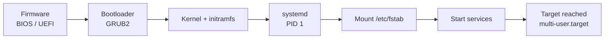

# 13 · Boot Process and Recovery

"The server didn't come back after a reboot" is a classic incident and a classic interview question. To fix it you need to know what happens between power-on and the login prompt, and how to get into a broken system.

## The boot sequence



| Stage | What happens | Where it's configured |
|---|---|---|
| Firmware | Hardware check, finds the boot disk | BIOS/UEFI settings (cloud: the hypervisor) |
| GRUB2 | Menu, picks the kernel and its parameters | `/etc/default/grub` → `update-grub` (Ubuntu) / `grub2-mkconfig -o /boot/grub2/grub.cfg` (RHEL) |
| Kernel + initramfs | Loads drivers, finds and mounts the root filesystem | `/boot/vmlinuz-*`, `/boot/initrd*` |
| systemd | Mounts filesystems, starts units in parallel | `/etc/systemd/system/`, `/etc/fstab` |
| Target | The end state | `systemctl get-default` |

## systemd targets (runlevels)

| Target | Old runlevel | Use |
|---|---|---|
| `multi-user.target` | 3 | Normal server: networking, no GUI |
| `graphical.target` | 5 | Desktop |
| `rescue.target` | 1 | Single user, local filesystems, root shell |
| `emergency.target` | none | Bare minimum, root filesystem read-only: where a bad fstab drops you |

## Essential commands

| Task | Command |
|---|---|
| How long did boot take? | `systemd-analyze` |
| Slowest services | `systemd-analyze blame` |
| Chain that delayed boot | `systemd-analyze critical-chain` |
| Logs of this boot / previous boot | `journalctl -b` · `journalctl -b -1 -p err` |
| Keep logs across reboots | `sudo mkdir -p /var/log/journal && sudo systemctl restart systemd-journald` |
| Reboot history | `last -x reboot` |
| Reboot needed after updates? | Ubuntu: `ls /var/run/reboot-required` · RHEL: `needs-restarting -r` |
| Default target | `systemctl get-default` · `sudo systemctl set-default multi-user.target` |
| Switch now | `sudo systemctl isolate rescue.target` |
| Kernel version and parameters | `uname -r` · `cat /proc/cmdline` |
| Test fstab without rebooting | `sudo findmnt --verify` · `sudo mount -a` |
| Rebuild initramfs | `sudo update-initramfs -u` (Ubuntu) · `sudo dracut -f` (RHEL) |

## Common boot failures

| Symptom | Likely cause | Fix |
|---|---|---|
| "You are in emergency mode" | Bad or missing disk in `/etc/fstab` | Log in, `mount -o remount,rw /`, fix fstab, add `nofail` to extra disks |
| `grub rescue>` prompt | GRUB can't find its files (disk or partition changed) | Boot a rescue ISO, reinstall GRUB |
| Kernel panic after an update | New kernel or initramfs broken | Pick the previous kernel in the GRUB menu, rebuild initramfs |
| Boot hangs on a service | A unit waiting for network or a disk | `systemd-analyze critical-chain`, fix or disable the unit |
| Cloud VM unreachable after reboot | Usually fstab or the firewall | Use the cloud **serial console**, or attach the disk to another VM and fix it |

**Lost root password** (on a machine you own): at the GRUB menu press `e`, add `rd.break` (RHEL) or `init=/bin/bash` (Ubuntu) to the `linux` line, boot, remount `/` read-write, run `passwd`. On RHEL also run `touch /.autorelabel` for SELinux.

## Script: `boot-health-check.sh`

Uptime and reboot history, pending reboots and newer kernels, boot time and slowest units, failed units, errors from the previous boot, `/boot` space, and a full `/etc/fstab` check (missing devices, missing mount points, missing `nofail`). Run it **before** every planned reboot.

```bash
sudo ./boot-health-check.sh
./boot-health-check.sh -f sample-fstab     # practice file with typical mistakes
```

## Practice tasks
1. Run the script on `sample-fstab` and fix every problem it reports.
2. On a test VM, add a fake disk to `/etc/fstab` without `nofail`, reboot, recover from emergency mode, then fix it.
3. Find the three slowest services on your VM with `systemd-analyze blame` and check whether you need them.
