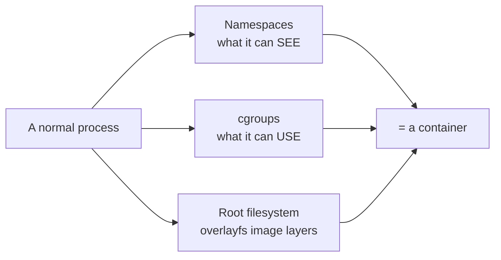

# 15 · Linux Behind Containers

Docker and Kubernetes don't have their own magic: a container is a **normal Linux process** that the kernel isolates with namespaces, limits with cgroups and gives its own filesystem. Knowing this makes container debugging much easier, and it's one of the most popular DevOps interview topics.

## The three building blocks



### Namespaces: what a process can see

| Namespace | Isolates | Effect inside the container |
|---|---|---|
| `pid` | Process IDs | Your app is PID 1 and can't see host processes |
| `net` | Network stack | Own interfaces, IPs, ports, routing table |
| `mnt` | Mount points | Own filesystem tree |
| `uts` | Hostname | Own hostname |
| `ipc` | Shared memory, semaphores | No interference with host IPC |
| `user` | User and group IDs | root inside can be an unprivileged user outside (rootless containers) |
| `cgroup` | cgroup view | Sees its own cgroup as the root |

### cgroups v2: what a process can use

| Docker flag | Kubernetes field | cgroup v2 file |
|---|---|---|
| `--memory=512m` | `resources.limits.memory` | `memory.max` |
| `--cpus=0.5` | `resources.limits.cpu: 500m` | `cpu.max` = `50000 100000` |
| `--pids-limit=100` | (pod pids limit) | `pids.max` |
| *(memory usage now)* | `kubectl top` | `memory.current` |

When a container goes over `memory.max`, the kernel's OOM killer stops it: exit code **137** and `OOMKilled` in Kubernetes.

### Filesystem: overlayfs

An image is a stack of read-only layers (`lowerdir`). The container gets one writable layer on top (`upperdir`); changes disappear with the container unless you use a volume (a bind mount).

## Essential commands

| Task | Command |
|---|---|
| List namespaces on the host | `sudo lsns` |
| Namespaces of a process | `ls -l /proc/<PID>/ns` |
| Run a command in new namespaces | `sudo unshare --pid --fork --mount-proc --uts bash` |
| Enter a container's namespaces | `sudo nsenter -t <PID> -n ip addr` (network) · `-a` (all) |
| Host PID of a Docker container | `docker inspect -f '{{.State.Pid}}' <name>` |
| A process's cgroup | `cat /proc/<PID>/cgroup` |
| Limits of a cgroup | `cat /sys/fs/cgroup/<path>/memory.max` |
| Run with limits (systemd) | `sudo systemd-run --scope -p MemoryMax=200M -p CPUQuota=50% <cmd>` |
| cgroup usage, like top | `systemd-cgtop` |
| Network namespaces | `sudo ip netns add test` · `sudo ip netns exec test ip a` |
| Capabilities of a process | `grep Cap /proc/<PID>/status` · `capsh --decode=<hex>` |

## Scripts

### `mini-container.sh`: a container from scratch, no Docker
Builds a tiny root filesystem by copying programs and their libraries (found with `ldd`), creates a cgroup with memory/CPU/process limits, then starts the command in new PID, UTS, mount, IPC and network namespaces inside a `chroot`.

```bash
sudo ./mini-container.sh                        # interactive shell inside the container
sudo ./mini-container.sh -- ps aux              # only PID 1 is visible
sudo ./mini-container.sh -H web-01 -- hostname  # own hostname, the host's is unchanged
sudo ./mini-container.sh -m 50M -- tail /dev/zero   # eats memory until the OOM killer stops it (exit 137)
```

### `inspect-namespaces.sh`: how is this process isolated?
For any PID or Docker container: which namespaces are isolated or shared with the host, how many processes share its PID namespace, hostname, network interfaces, root filesystem and overlay layers, cgroup limits, capabilities and seccomp.

```bash
sudo ./inspect-namespaces.sh 1234
sudo ./inspect-namespaces.sh my-nginx        # Docker container name
```

## Practice tasks
1. Start `sudo ./mini-container.sh -- sleep 300` in one terminal and inspect it from another with `inspect-namespaces.sh $(pgrep -n sleep)`.
2. Run `docker run -d --memory=100m --cpus=0.5 nginx`, inspect it, and find `memory.max` and `cpu.max`.
3. Run `sudo nsenter -t <PID> -n ss -tlnp` to see the ports listening inside a container without `docker exec`.
