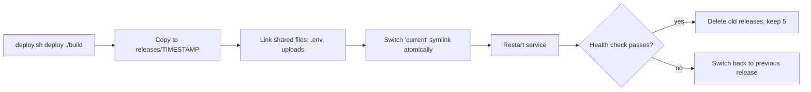

# Project 3 · App Deployment with Automatic Rollback

A deployment script that ships a new release with zero downtime, checks that it is healthy, and **rolls back by itself** if it isn't. It uses the releases-and-symlink pattern behind Capistrano, Deployer and many CI/CD pipelines.

## How it works



```
/opt/myapp/
├── releases/
│   ├── 20261127-101500/
│   └── 20261127-120000/
├── shared/                 .env, uploads, logs: kept between releases
└── current -> releases/20261127-120000
```

Switching is one atomic `mv` of a symlink, so users never hit a half-copied release.

## Commands

```bash
./deploy.sh deploy <dir | app.tar.gz>   # deploy, health check, auto-rollback on failure
./deploy.sh rollback                     # go back one release
./deploy.sh list                         # releases, * marks current
./deploy.sh status                       # current release and health
```

Settings come from environment variables:

| Variable | Default | Meaning |
|---|---|---|
| `APP_DIR` | `/opt/myapp` | Where releases live |
| `KEEP_RELEASES` | `5` | Releases to keep |
| `SERVICE_NAME` | (none) | systemd service to restart after switching |
| `HEALTH_URL` | (none) | Must return 2xx after deploy |
| `HEALTH_RETRIES` | `5` | Attempts, 2 seconds apart |

## Try it in 2 minutes

The `sample-app/` folder has three versions: `v1`, `v2` and `v3-broken` (no health endpoint).

```bash
export APP_DIR=/tmp/myapp HEALTH_URL=http://localhost:8080/health HEALTH_RETRIES=2
mkdir -p /tmp/myapp

# Terminal 1: a web server that always serves the 'current' release
python3 -m http.server 8080 --directory /tmp/myapp/current

# Terminal 2
./deploy.sh deploy sample-app/v1        # open http://localhost:8080 → version 1
./deploy.sh deploy sample-app/v2        # → version 2
./deploy.sh deploy sample-app/v3-broken # health check fails → automatic rollback to version 2
./deploy.sh list
./deploy.sh rollback                    # → version 1
```

## Linux skills used
Symbolic links and atomic `mv -T` · `flock` locking · `tar` · `curl` health checks with retries · systemd restarts · arrays and `mapfile` · subcommand-style CLI · exit codes for CI/CD

## Use it from CI/CD
GitHub Actions example step (after building `app.tar.gz` and copying it to the server):
```yaml
- name: Deploy
  run: ssh deploy@server "APP_DIR=/opt/myapp SERVICE_NAME=myapp HEALTH_URL=http://localhost:8080/health /opt/deploy.sh deploy /tmp/app.tar.gz"
```
A failed health check returns exit code `1`, so the pipeline turns red, and the server is already back on the previous release.

## Ideas to extend it
- Run database migrations before switching
- Post deploy and rollback events to Slack
- Blue/green: two ports plus an nginx upstream switch instead of a symlink
